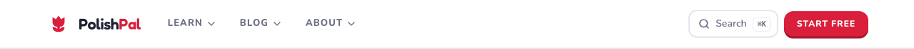
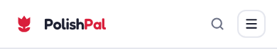
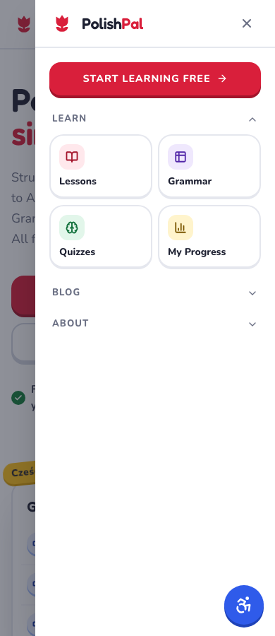
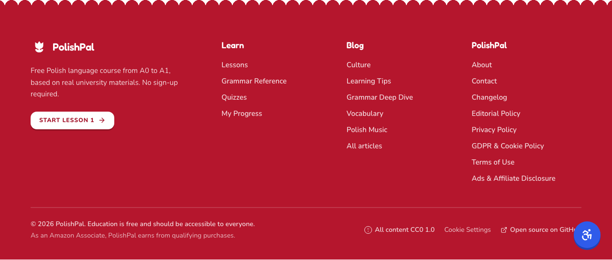
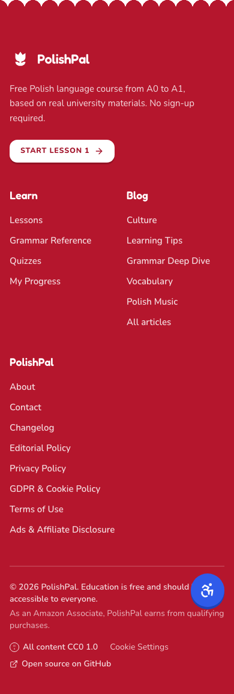

# Hello bloom — selected PolishPal logo

The selected concept A is a flat, single-ink tulip inspired by wycinanki. The production master is `public/logo.svg`: two paths, a 512 viewBox, transparent openings, and the required accessible attributes. White and ink versions share the same geometry. Use the white version on crimson or dark ink grounds.

The mark’s furthest visible pixel lies 180.7px from its center, inside the 204.8px radius of the central 80%-diameter maskable safe circle. App icons use an opaque white background; the favicon uses a tighter 384-unit viewBox around the same silhouette to keep its crown, stem, and leaves visible at 16px. Each ICO frame is rendered at its native size, without downsampling from a larger frame.

The header and mobile drawer use the crimson 36px mark with the site's live 22px Fredoka semibold “Polish**Pal**” wordmark (loaded through `next/font`). The footer sits on crimson, so it uses `logo-white.svg` at 36px with an all-white wordmark. The redesigned site is light-only, so there is no dark-mode variant to switch to.

The OG composition retains the previous large-left-mark/right-hand-wordmark arrangement, with the exact tagline “Learn Polish free” and the domain. Its flat crimson field and dark bottom edge use the requested palette. Fredoka 600 and Nunito 700/600 are rendered directly from the bundled font files.


## Regeneration

From the repository root, with Playwright/Chromium and Python Pillow available:

```sh
node scripts/generate-brand-assets.mjs
```

When Chromium is unavailable, the installed Sharp SVG renderer can generate the same raster asset set:

```sh
node scripts/generate-brand-assets.mjs --sharp
```

Pillow assembles the independently rasterized 16/32/48px ICO frames, typesets the OG image, and opens every PNG and ICO frame to verify dimensions and opacity. The committed raster assets were generated with Sharp. `asset-proof.png` is a raster review sheet, not an application screenshot; the real browser captures are in `screenshots/`.

For browser captures, after a production build and `npx next start`:

```sh
node design/logo-concepts/render.mjs
node scripts/screenshot-brand.mjs
```

The latter captures the header and footer at 1280px/390px and the 390px mobile drawer. It asserts that the header, footer and drawer marks render at 36×36, that there is no horizontal overflow, and that the mobile menu stays hidden at desktop width.

## Verification (2026-11-05)

Run in the logo worktree after merging current `origin/main` into `brand/new-logo` (code conflicts resolved toward main, with the logo changes re-applied) and a clean `npm ci`:

- `npx tsc --noEmit`: passed.
- `npx eslint`: 0 errors, 18 warnings, none introduced by this change.
- `npx next build`: passed with normal network access (Turbopack, Google Fonts fetched, 161 static pages).
- `node design/logo-concepts/render.mjs`: passed; wrote `../preview.png` and the Chromium 16/512px proofs.
- `npx next start --port 3000` + `node scripts/screenshot-brand.mjs`: passed. All three 36px marks decode at 36×36, with no overflow at 1280/390px, and the menu button is hidden at 1280px. Captures are in `screenshots/`.
- Served HTML: `theme-color` `#D91F3B`, `.ico` + SVG favicon, 180px Apple icon, manifest with 192/512 PNGs for `any` and `maskable`.
- Pillow: the 192/512/180 icons and the OG image are opaque at their exact sizes and contain `#D91F3B`; the ICO has exactly 16/32/48 frames with transparency.







Existing `/logo.svg` URLs in JSON-LD Organization/publisher metadata and contributor avatars automatically resolve to the new master. No blog images, `public/blog/*`, blog content, or environment files are included in the change.
