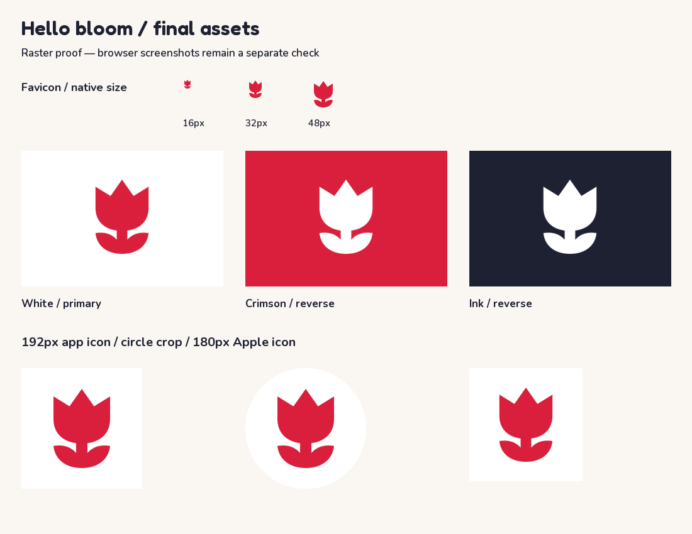

# Hello bloom — selected PolishPal logo

The selected concept A is a flat, single-ink tulip inspired by wycinanki. The production master is `public/logo.svg`: two paths, a 512 viewBox, transparent openings, and the required accessible attributes. White and ink versions share the same geometry. Use the white version on crimson or dark ink grounds.

The mark’s furthest visible pixel lies 180.7px from its center, inside the 204.8px radius of the central 80%-diameter maskable safe circle. App icons use an opaque white background; the favicon uses a tighter 384-unit viewBox around the same silhouette to keep its crown, stem, and leaves visible at 16px. Each ICO frame is rendered at its native size, without downsampling from a larger frame.

The header, footer, and mobile drawer use a 36px mark with a 22px Fredoka semibold live wordmark. The mark reverses to white in dark mode. The Fredoka Latin subset and its license are self-hosted. The rest of the older blue site styling is outside this logo change.

The OG composition retains the previous large-left-mark/right-hand-wordmark arrangement, with the exact tagline “Learn Polish free” and the domain. Its flat crimson field and dark bottom edge use the requested palette. Fredoka 600 and Nunito 700/600 are rendered directly from the bundled font files.



## Regeneration

From the repository root, with Playwright/Chromium and Python Pillow available:

```sh
node scripts/generate-brand-assets.mjs
```

When Chromium is unavailable, the installed Sharp SVG renderer can generate the same raster asset set:

```sh
node scripts/generate-brand-assets.mjs --sharp
```

Pillow assembles the independently rasterized 16/32/48px ICO frames, typesets the OG image, and opens every PNG and ICO frame to verify dimensions and opacity. The committed raster assets were generated with Sharp because Chromium could not launch in the sandbox. `asset-proof.png` is a raster review sheet, not an application screenshot.

For browser captures, after a production build and `npx next start`:

```sh
node design/logo-concepts/render.mjs
node scripts/screenshot-brand.mjs
```

The latter captures the header and footer at 1280px/390px and the 390px mobile drawer, in both light and dark modes. It checks the header mark’s size and horizontal overflow; the mobile menu must stay hidden at desktop width.

## Verification in this environment

- `npx tsc --noEmit`: passed, including generated production route types.
- `npx eslint`: passed with 20 existing warnings. Two existing unescaped quotes in CMS helper text were escaped so the requested full lint run could pass; visible text is unchanged.
- Native-size raster checks: all three Phase 1 concepts at five sizes and four color treatments passed (60 checks).
- Every final PNG and ICO frame opened in Pillow at the expected size. App and Apple icons are opaque; ICO frames preserve transparency.
- `npx next build`: blocked by fetching the existing Inter font from Google Fonts because network/DNS is unavailable.
- Supplemental Turbopack build with cached Inter fonts: blocked by sandbox permissions for its internal port binding.
- Supplemental `npx next build --webpack`, with `NEXT_FONT_GOOGLE_MOCKED_RESPONSES` pointing to a temporary local response containing the exact seven Inter font files from the existing checkout’s build cache: passed, compiling and generating all 52 static pages. The font response fixture is outside the repository and is not a production code change. This does not substitute for the requested default build in an unrestricted environment.
- The generated homepage HTML contains all three logo references, live split wordmarks, the Apple icon, the manifest link, and the crimson theme color. The generated manifest declares both icon sizes for `any` and `maskable` use.
- `npx next start --port 3000`: denied permission to bind `0.0.0.0:3000`. Chromium also fails its macOS MachPortRendezvousServer registration. Consequently the requested browser screenshots, including Phase 1 `preview.png`, remain pending.
- GitHub DNS is unavailable, so publishing the branch and opening the PR require a network-enabled environment. The PR description is prepared in `PR.md`. Do not merge; Vercel preview failure is expected per the task brief.

Existing `/logo.svg` URLs in JSON-LD Organization/publisher metadata and contributor avatars automatically resolve to the new master. No blog images, `public/blog/*`, blog content, or environment files are included in the change.
